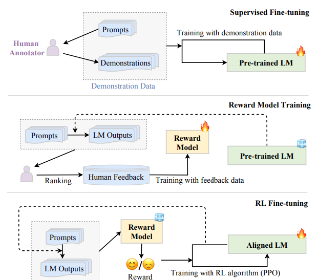

# A survey on Reinforcement Learning from Human Feedback for LLM

**Abstract**

Large Language Models (LLMs) have demonstrated remarkable capabilities in various natural language processing (NLP) tasks, such as machine translation, text generation, and question answering. However, these models often fail to generate human-aligned outputs, exhibiting biases, incoherency, and lack of diversity in their responses. One promising approach to overcome these limitations is Reinforcement Learning from Human Feedback (RLHF), which enables LLMs to iteratively improve their outputs based on human evaluative feedback. This technique leverages reinforcement learning (RL) algorithms to fine-tune model behavior by using human feedback as a reward signal. RLHF is seen as a powerful method for aligning LLMs with human values and improving their generation quality across a range of tasks.

In this review, we provide a comprehensive overview of the RLHF technique in the context of LLMs. We explore the background and foundational principles of RLHF, discuss the main challenges and limitations it faces, and examine the state-of-the-art methods developed to address these challenges. Additionally, we consider future research directions and potential applications of RLHF in training more responsible and human-aligned LLMs.

## 1. Introduction

Large Language Models (LLMs) have achieved impressive performance across a wide array of natural language processing (NLP) tasks, from generating coherent and contextually relevant text to performing complex reasoning tasks. Models such as GPT, Llama, and Qwen have demonstrated state-of-the-art results, leveraging vast amounts of unsupervised data to learn language patterns. Despite their success, these models frequently generate outputs that do not align with user intent or societal values. They may produce biased content, irrelevant information, or even offensive text, posing significant challenges when deployed in real-world applications.

Traditional training methods for LLMs, primarily based on supervised learning, depend on vast amounts of labeled data. However, this approach fails to fully capture the nuances of human expectations. Even when fine-tuned on domain-specific datasets, LLMs can still misinterpret complex or subjective user inputs, leading to suboptimal or harmful outputs. Moreover, supervised learning methods do not allow for continuous model improvement once the training phase is complete.

Reinforcement Learning from Human Feedback (RLHF) has emerged as a promising solution to this problem, enabling models to learn from human evaluators instead of relying solely on pre-labeled data. By incorporating human feedback as a reward signal in the reinforcement learning process, RLHF allows LLMs to adjust their behavior in an iterative fashion, making them better aligned with human goals, preferences, and ethical standards. RLHF leverages the ability of reinforcement learning to optimize complex decision-making tasks by aligning model outputs with human feedback.

his review explores RLHF in the context of LLMs, delving into the background, limitations, challenges, and methods associated with this technique. We also discuss the ongoing research efforts and potential future directions for RLHF in making LLMs more adaptable, responsible, and human-centric.

<figure>
  
  <figcaption> Fig. 1: The workflow of RLHF algorithm. </figcaption>
</figure>

T

## 2. Background

LLMs have revolutionized the field of NLP by learning from massive amounts of textual data, capturing intricate language structures and semantic relationships. These models, trained using unsupervised or semi-supervised learning techniques, can generate human-like text by predicting the next word in a sequence given the preceding context. However, despite their language prowess, LLMs are not perfect at aligning with human preferences, needs, or ethical considerations.

The main shortcoming of LLMs lies in their reliance on vast, static datasets for training. These datasets can contain biases, inaccuracies, and imbalances that lead to undesirable outputs. For instance, a model trained on internet data may learn to generate text that reflects harmful stereotypes or misinformation. Moreover, LLMs may lack the capability to understand subtle nuances in human intent, which is particularly problematic when models are expected to engage in complex tasks like negotiation, customer support, or content moderation.

Incorporating human feedback into the training process offers a solution. Instead of relying solely on static datasets, LLMs trained with RLHF continuously improve by adapting to human-provided feedback. This feedback can take various forms, such as rankings, ratings, or binary evaluations (e.g., good/bad). The feedback is used to adjust the model's reward function, which in turn influences the model's decision-making process.

Human feedback helps guide the model’s learning process in a more dynamic and context-sensitive manner. By focusing on tasks that are difficult to encode directly in a training dataset, RLHF allows for more flexible and nuanced adjustments to the model’s behavior. RLHF has shown promise in addressing issues like bias, toxicity, and incoherence, improving the quality and ethical alignment of LLM outputs.

## 3. Limitations and Challenges of RLHF

While RLHF offers a more dynamic and human-aligned approach to training LLMs, several challenges limit its effectiveness in real-world applications. These challenges include:

1. **Feedback Collection Cost**: Human feedback is expensive and time-consuming to collect, especially for large-scale models. Evaluating model outputs requires skilled annotators who can provide consistent and accurate feedback, a process that can be resource-intensive.

2. **Subjectivity and Inconsistency**: Human feedback is inherently subjective, and different evaluators may have conflicting opinions on what constitutes a “good” or “bad” response. Variability in feedback can lead to inconsistent reward signals, making it difficult for the model to learn a stable policy.

3. **Feedback Bias**: Human evaluators may introduce their own biases into the feedback, leading to undesirable reinforcement of certain behaviors. For example, evaluators may unintentionally favor responses that align with their own beliefs, potentially reinforcing harmful stereotypes or unethical content.

4. **Reward Function Design**: One of the critical challenges of RLHF is designing a reward function that accurately reflects human values. Crafting a reward function that is both effective and ethical requires careful consideration of what constitutes "good" behavior across a range of tasks. Poorly designed reward functions can lead to unintended consequences, such as the model optimizing for behavior that is technically rewarded but ethically problematic.

5. **Scalability**: RLHF typically requires numerous iterations to achieve optimal performance, which can make it less scalable for large language models. The need for repeated human evaluations in each iteration, combined with the computational complexity of reinforcement learning algorithms, can significantly slow down the training process.

6. **Exploration vs. Exploitation**: RLHF faces the challenge of balancing exploration and exploitation. While exploration allows the model to discover new behaviors and improve in novel scenarios, over-exploration can lead to inefficient learning and instability, especially when human feedback is limited.

## 4. Methods

To overcome the challenges of RLHF, several methods and techniques have been developed to enhance the effectiveness and efficiency of the feedback loop. These include:

1. **Reward Modeling**: This technique involves using human feedback to create a surrogate reward model that predicts the preferences of human evaluators. The model can then optimize its output based on the surrogate reward, reducing the need for constant human input. 

2. **Inverse Reinforcement Learning (IRL)**: IRL aims to learn the reward function by observing human behavior rather than directly asking for feedback. This approach allows the model to infer the implicit preferences of humans, potentially reducing bias and improving the efficiency of feedback collection.

3. **Imitation Learning**: In imitation learning, the model learns to replicate human actions or responses by mimicking a dataset of human behavior. This method can be combined with RLHF to reduce the amount of direct feedback needed and speed up the learning process.

4. **Human Preference Modeling**: This technique involves modeling human preferences based on historical feedback, enabling the model to predict the most likely human-approved actions for a given scenario. This approach can help reduce the need for repeated human evaluations and improve the model’s adaptability.

5. **Multi-Agent RLHF**: Multi-agent RLHF leverages multiple models or evaluators to gather a more diverse set of human feedback. This can help mitigate biases introduced by individual evaluators and improve the robustness of the learning process.

## 5. Discussion

Although RLHF presents a promising approach to improving the alignment of LLMs with human expectations, several open questions remain. One critical area of future research is improving the scalability of RLHF, particularly in reducing the cost and time associated with collecting high-quality human feedback. Innovations in active learning, unsupervised learning, and semi-supervised approaches could help address these concerns.

Moreover, ensuring the ethical alignment of RLHF-trained models is essential as they are increasingly deployed in high-stakes applications, such as healthcare, law, and education. Ensuring that models respect privacy, fairness, and societal values remains an ongoing challenge.

Finally, RLHF techniques must continue to evolve to handle increasingly complex tasks. As LLMs are expected to perform a wider range of duties, from creative writing to interactive dialogue and problem-solving, RLHF can be an important tool to help models navigate the complexities of human intention and ethical behavior.

尽管 RLHF 已被证明是一种较为有效的语言模型对齐技术，但是它也存在一
些局限性。首先，在 RLHF 的训练过程中，需要同时维护和更新多个模型，这些
模型包括策略模型、奖励模型、参考模型以及评价模型。这不仅会占用大量的内
存资源，而且整个算法的执行过程也相对复杂。此外，RLHF 中常用的近端策略优
化算法在优化过程中的稳定性欠佳，对超参数的取值较为敏感，这进一步增加了
模型训练的难度和不确定性。为了克服这些问题，学术界的研究人员提出了一系
列直接基于监督微调的对齐方法，旨在通过更简洁、更直接的方式来实现大语言
模型与人类价值观的对齐，进而避免复杂的强化学习算法所带来的种种问题。

## Reference

Deep Reinforcement Learning from Human Preferences (Christiano et al. 2017): RLHF applied on preferences between Atari trajectories.

Fine-Tuning Language Models from Human Preferences (Zieglar et al. 2019): An early paper that studies the impact of reward learning on four specific tasks.

Learning to summarize with human feedback (Stiennon et al., 2020): RLHF applied to the task of summarizing text. Also, Recursively Summarizing Books with Human Feedback (OpenAI Alignment Team 2021), follow on work summarizing books.

WebGPT: Browser-assisted question-answering with human feedback (OpenAI, 2021): Using RLHF to train an agent to navigate the web.

InstructGPT: Training language models to follow instructions with human feedback (OpenAI Alignment Team 2022): RLHF applied to a general language model [Blog post on InstructGPT].

GopherCite: Teaching language models to support answers with verified quotes (Menick et al. 2022): Train a LM with RLHF to return answers with specific citations.

Sparrow: Improving alignment of dialogue agents via targeted human judgements (Glaese et al. 2022): Fine-tuning a dialogue agent with RLHF

ChatGPT: Optimizing Language Models for Dialogue (OpenAI 2022): Training a LM with RLHF for suitable use as an all-purpose chat bot.

Scaling Laws for Reward Model Overoptimization (Gao et al. 2022): studies the scaling properties of the learned preference model in RLHF.

Training a Helpful and Harmless Assistant with Reinforcement Learning from Human Feedback (Anthropic, 2022): A detailed documentation of training a LM assistant with RLHF.

Red Teaming Language Models to Reduce Harms: Methods, Scaling Behaviors, and Lessons Learned (Ganguli et al. 2022): A detailed documentation of efforts to “discover, measure, and attempt to reduce [language models] potentially harmful outputs.”

Dynamic Planning in Open-Ended Dialogue using Reinforcement Learning (Cohen at al. 2022): Using RL to enhance the conversational skill of an open-ended dialogue agent.