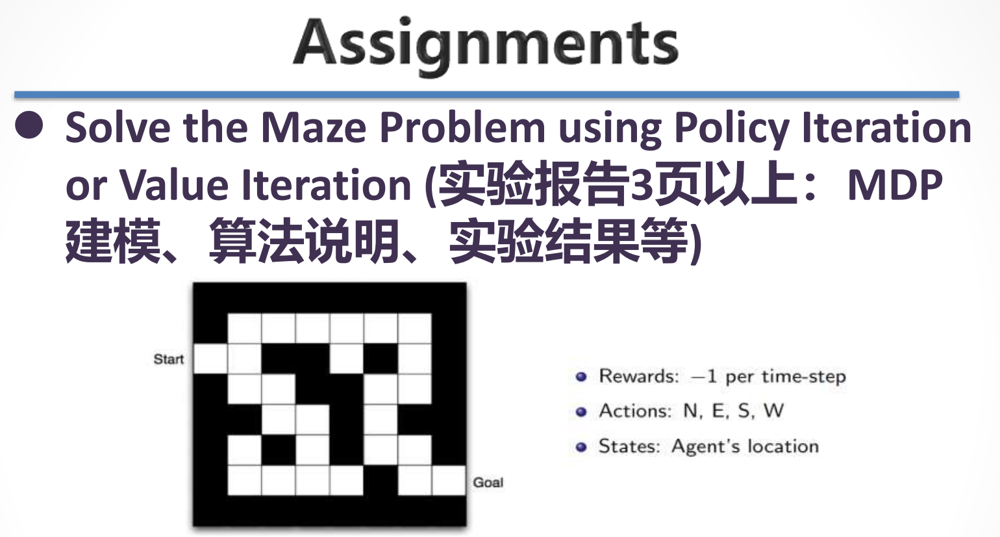
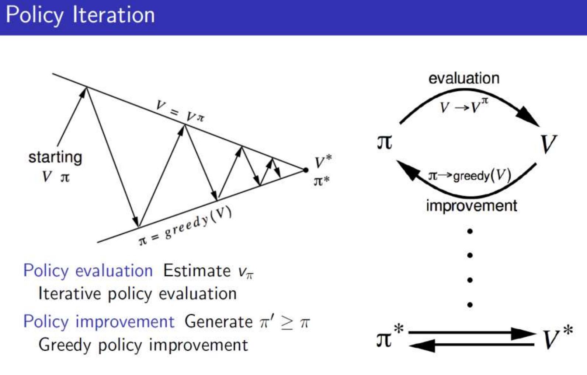
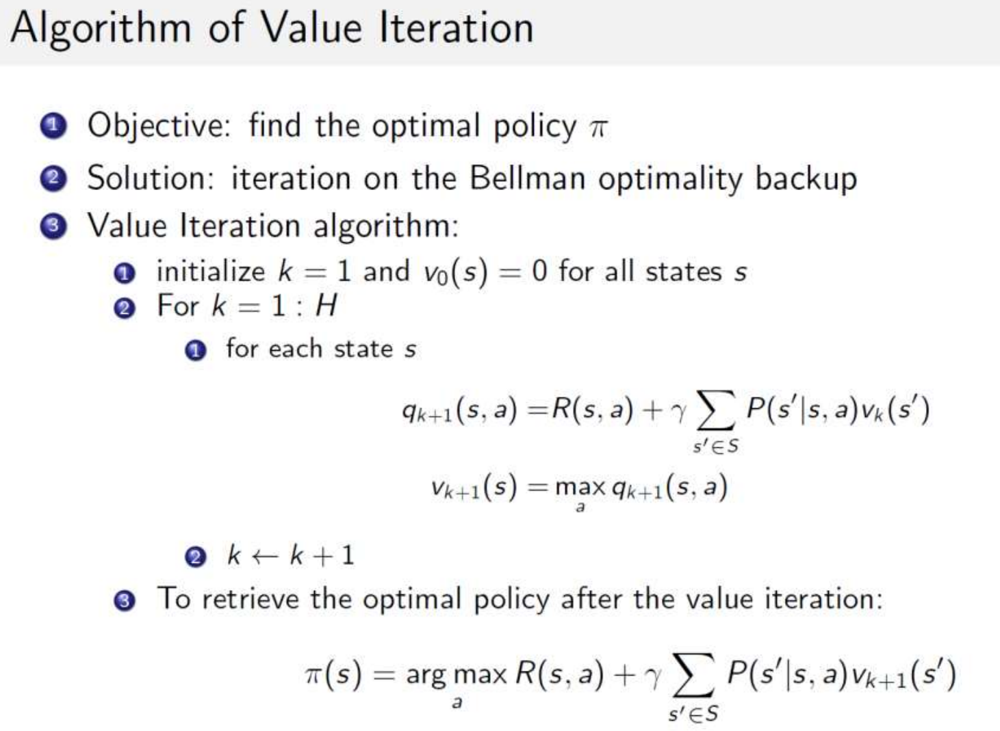
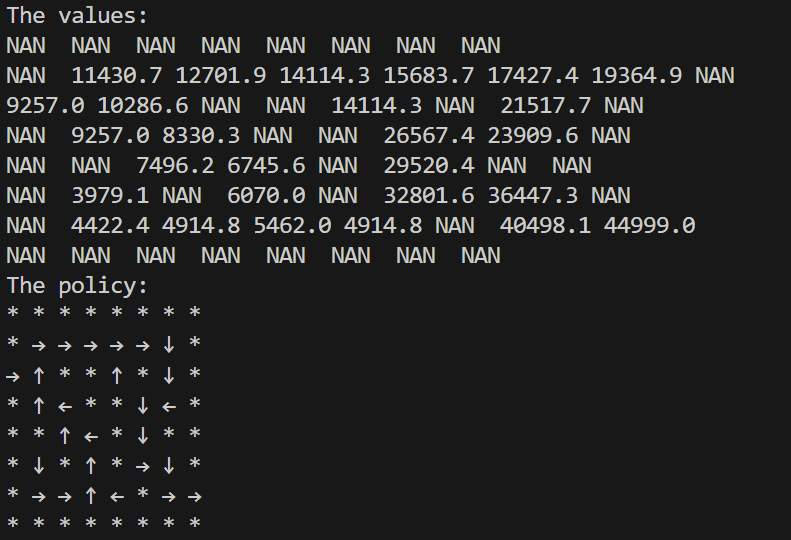
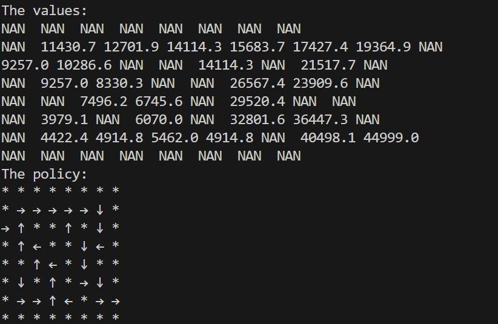

# 《强化学习》第一次作业: Solve the Maze Problem using Policy Iteration or Value Iteration
## 一、实验内容


## 二、MDP建模


### 1. 定义状态空间 \( S \)
每个状态代表迷宫中的一个位置。假设迷宫是一个二维网格，状态可以表示为 \((x, y)\)，其中 \(x\) 和 \(y\) 是位置的坐标。

### 2. 定义动作空间 \( A \)
可采取的动作通常包括移动到相邻的单元格
- 上移（向上）
- 下移（向下）
- 左移（向左）
- 右移（向右）

这里在代码中用0,1,2,3索引代替上述动作。

### 3. 定义转移概率 \( P \)
转移概率 \( P(s' | s, a) \) 表示在状态 \( s \) 下采取动作 \( a \) 后转移到状态 \( s' \) 的概率。由于在迷宫问题中，这是确定性的，即如果在状态 \( s \) 下采取动作 \( a \)，则会以概率 1 转移到状态 \( s' \)。

所以所有状态能采取的动作的转移概率都为1。
### 4. 定义奖励函数 \( R \)
奖励函数 \( R(s, a) \) 定义了在状态 \( s \) 下采取动作 \( a \) 的即时奖励。在迷宫中，设置奖励为：
- 未到达目标状态的每走一步： -1
- 达到目标状态 : 50000

### 5. 定义折扣因子 \( \gamma \)
折扣因子 \( \gamma \) 在 \( [0, 1] \) 之间，决定未来奖励的影响程度。接近 1 时，未来奖励的重要性较高；接近 0 时，强调即时奖励。

代码中设为0.9 。
### 6. 价值函数和策略
- **价值函数 \( V(s) \)**：表示从状态 \( s \) 开始，遵循某一策略所能获得的期望总奖励，即代码中的values。
- **策略 \( \pi(a | s) \)**：在状态 \( s \) 下采取动作 \( a \) 的概率。可以是确定性策略（每个状态只对应一个动作）或随机策略，即代码中的policy。


## 三、算法设计说明
### 1. 对迷宫、状态集合S、奖励机制R 和 动作转移概率 $P(s^{'}|s,a)$的初始化
```python
# 迷宫: 1为障碍 / 0为通道
maze = np.array([
    [ 1.,  1.,  1.,  1.,  1.,  1.,  1.,  1.],
    [ 1.,  0.,  0.,  0.,  0.,  0.,  0.,  1.],
    [ 0.,  0.,  1.,  1.,  0.,  1.,  0.,  1.],
    [ 1.,  0.,  0.,  1.,  1.,  0.,  0.,  1.],
    [ 1.,  1.,  0.,  0.,  1.,  0.,  1.,  1.],
    [ 1.,  0.,  1.,  0.,  1.,  0.,  0.,  1.],
    [ 1.,  0.,  0.,  0.,  0.,  1.,  0.,  0.],
    [ 1.,  1.,  1.,  1.,  1.,  1.,  1.,  1.]
])

dimensions = maze.shape[0] # 迷宫维度
terminal_state = (6,8) # 终止状态

actions = [(-1,0),(1,0),(0,-1),(0,1)] # 动作集合: 上下左右

# 状态集合
states = []
for i in range(dimensions): # 搜索合法的状态 
        for j in range(dimensions):
            if(maze[i][j]==0):
                states.append((i,j))
                
# 奖励
reward = np.ones((dimensions,dimensions))
reward = -reward 

# 动作转移概率
P_a =  np.zeros((dimensions,dimensions,4))          
for s in states:
    row = s[0] 
    col = s[1]
    valid_actions = []
    for i in range(len(actions)):
        new_row = row + actions[i][0] 
        new_col = col + actions[i][1]
        if new_row < 0 or new_col < 0 or new_row >= dimensions or new_col >= dimensions:
            continue
        else:
            if maze[new_row][new_col] == 0 :
                valid_actions.append(i)
    for ns in valid_actions:
        P_a[row][col][ns] = 1 

# 对最接近出口的状态做特殊处理,使其可以走出迷宫 
P_a[6][7][2] = 1
P_a[6][7][3] = 1

```
### 2. policy iteration
#### policy iteration 过程：

#### policy iteration 实现代码:
```python
def policy_iteration(discount_factor = 0.9 , iterations = 10000):
    states_num = len(states)
    values = np.zeros(states_num)
    
    # 初始化每个状态的策略(找到上下左右中第一个可行的动作最为初始的策略) 
    policy = np.zeros(states_num)
    policy = policy.astype(int)
    for i in range(states_num):
        row = states[i][0]
        col = states[i][1]
        for j in range(4):
            if P_a[row][col][j] > 0:
                policy[i] = j
                break
    
    for i in range(iterations):
        # policy-evaluation 过程
        e = 0.0001 # 收敛条件
        q_values = np.zeros(states_num) # 当前策略的价值
        while True:
            old_q_values = q_values.copy()
            for s_idx in range(states_num):
                # 下一步状态
                row = states[s_idx][0]
                col = states[s_idx][1]
                new_row = row + actions[int(policy[s_idx])][0] 
                new_col = col + actions[int(policy[s_idx])][1]
                if new_row == terminal_state[0] and new_col == terminal_state[1]: # 到达出口
                    q_values[s_idx] = P_a[row][col][int(policy[s_idx])] * (reward[row][col] + discount_factor * 50000)
                else : # 未到达出口
                    new_value_index = states.index((new_row,new_col))
                    q_values[s_idx] = P_a[row][col][int(policy[s_idx])] * (reward[row][col] + discount_factor * old_q_values[new_value_index])
            
            if np.sum(np.fabs(q_values - old_q_values)) < e: # 达到收敛条件, 跳出policy-evaluation过程
                break
            
        # policy-improvement
        old_values = q_values.copy()
        old_policy = policy.copy()
        # 计算并判断是否达到最佳策略
        for s_idx in range(states_num):
            row = states[s_idx][0]
            col = states[s_idx][1]
            values_for_action = []
            for a_idx in range(len(actions)):
                if P_a[row][col][a_idx] == 0: 
                    continue
                # 下一步状态
                new_row = row + actions[a_idx][0] 
                new_col = col + actions[a_idx][1]
                if new_row == terminal_state[0] and new_col == terminal_state[1]:# 到达出口
                    values_for_action.append((P_a[row][col][a_idx] * (reward[row][col] + discount_factor * 50000),a_idx))
                else : #未达到出口
                    new_value_index = states.index((new_row,new_col))
                    values_for_action.append((P_a[row][col][a_idx] * (reward[row][col] + discount_factor * old_values[new_value_index]),a_idx))
            max_value = max(values_for_action, key=lambda x: x[0])
            values[s_idx] = max_value[0] 
            policy[s_idx] = max_value[1] 
        # 判断是否达到最佳策略    
        if np.all(policy == old_policy):
            break
    return values,policy
```
首先进行policy evaluation过程,不断将当前采取策略的价值迭代至收敛:
```python
# policy-evaluation 过程
        e = 0.0001 # 收敛条件
        q_values = np.zeros(states_num) # 当前策略的价值
        while True:
            old_q_values = q_values.copy()
            for s_idx in range(states_num):
                # 下一步状态
                row = states[s_idx][0]
                col = states[s_idx][1]
                new_row = row + actions[int(policy[s_idx])][0] 
                new_col = col + actions[int(policy[s_idx])][1]
                if new_row == terminal_state[0] and new_col == terminal_state[1]: # 到达出口
                    q_values[s_idx] = P_a[row][col][int(policy[s_idx])] * (reward[row][col] + discount_factor * 50000)
                else : # 未到达出口
                    new_value_index = states.index((new_row,new_col))
                    q_values[s_idx] = P_a[row][col][int(policy[s_idx])] * (reward[row][col] + discount_factor * old_q_values[new_value_index])
            
            if np.sum(np.fabs(q_values - old_q_values)) < e: # 达到收敛条件, 跳出policy-evaluation过程
                break
```
再进行policy improvment，计算出当前最佳策略,若与当前策略一直则退出迭代，否则回到policy evaluation阶段:
```python
# policy-improvement
        old_values = q_values.copy()
        old_policy = policy.copy()
        # 计算并判断是否达到最佳策略
        for s_idx in range(states_num):
            row = states[s_idx][0]
            col = states[s_idx][1]
            values_for_action = []
            for a_idx in range(len(actions)):
                if P_a[row][col][a_idx] == 0: 
                    continue
                # 下一步状态
                new_row = row + actions[a_idx][0] 
                new_col = col + actions[a_idx][1]
                if new_row == terminal_state[0] and new_col == terminal_state[1]:# 到达出口
                    values_for_action.append((P_a[row][col][a_idx] * (reward[row][col] + discount_factor * 50000),a_idx))
                else : #未达到出口
                    new_value_index = states.index((new_row,new_col))
                    values_for_action.append((P_a[row][col][a_idx] * (reward[row][col] + discount_factor * old_values[new_value_index]),a_idx))
            max_value = max(values_for_action, key=lambda x: x[0])
            values[s_idx] = max_value[0] 
            policy[s_idx] = max_value[1] 
        # 判断是否达到最佳策略    
        if np.all(policy == old_policy):
            break
```

### 3. value iteration
#### value iteration 伪代码:

#### value iteration 实现代码:
```python
def value_iteration(discount_factor = 0.9 , iterations = 10000):
    states_num = len(states)
    values = np.zeros(states_num)
    policy = np.zeros(states_num)
    e = 0.001 # 收敛条件
    
    for i in range(iterations):
        old_values = values.copy()
        for s_idx in range(states_num): # 对每个状态计算
            row = states[s_idx][0]
            col = states[s_idx][1]
            values_for_action = []
            for a_idx in range(len(actions)): # 遍历每种动作
                if P_a[row][col][a_idx] == 0:
                    continue
                # 下一步状态
                new_row = row + actions[a_idx][0] 
                new_col = col + actions[a_idx][1]
                if new_row == terminal_state[0] and new_col == terminal_state[1]: # 到达出口
                    values_for_action.append((P_a[row][col][a_idx] * (reward[row][col] + discount_factor * 50000),a_idx))
                else :
                    new_value_index = states.index((new_row,new_col)) # 未达到出口
                    values_for_action.append((P_a[row][col][a_idx] * (reward[row][col] + discount_factor * old_values[new_value_index]),a_idx))
            max_value = max(values_for_action, key=lambda x: x[0])
            values[s_idx] = max_value[0] 
            policy[s_idx] = max_value[1] # 这里跟踪记录对应的策略, 简化后续提取策略的步骤
        # 判断是否收敛
        if np.sum(np.fabs(values - old_values)) < e :
            break
    return values , policy
```
对每种状态计算其采用不同动作的期望价值value,将所有动作中产生期望价值最大的价值记录values下来,直到最后的价值收敛或者达到最大的迭代次数,由于在迭代过程中记录了每一次迭代每个状态产生期望价值动作，所以也记录下了最佳策略policy。

### 4. 实验结果可视化
```python
# 可视化values
def show_values(values):
    print("The values:")
    for i in range(dimensions):
        for j in range(dimensions):
            if (i,j) in states:
                index = states.index((i,j))
                print(f"{values[index]:4.1f}", end=' ')
            else :
                print(f"{'NAN':<4}", end=' ')
        print()        

# 可视化policy     
def show_policy(policy,actions_to_char):
    print("The policy:")
    for i in range(dimensions):
        for j in range(dimensions):
            if (i,j) in states:
                index = states.index((i,j))
                print(actions_to_char[policy[index]] ,end=' ')
            else :
                print("*" ,end = ' ')
        print()
```
## 四、实验结果
### policy iteration:

### values iteration:

