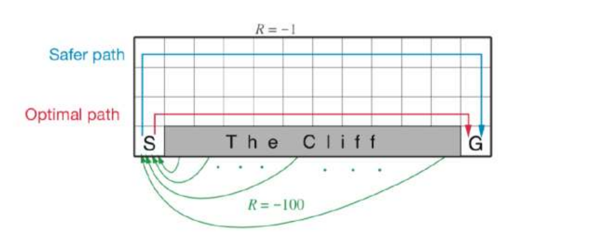
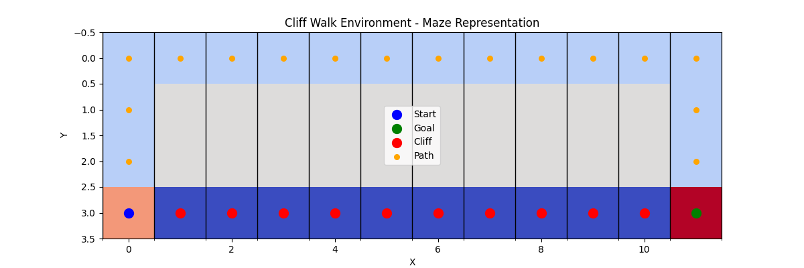
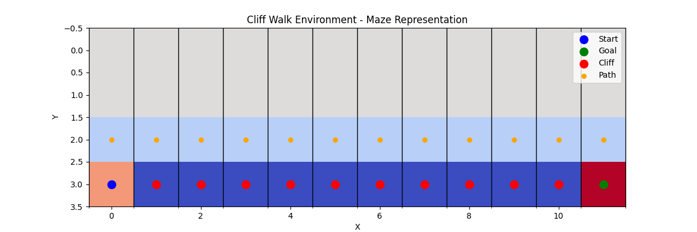
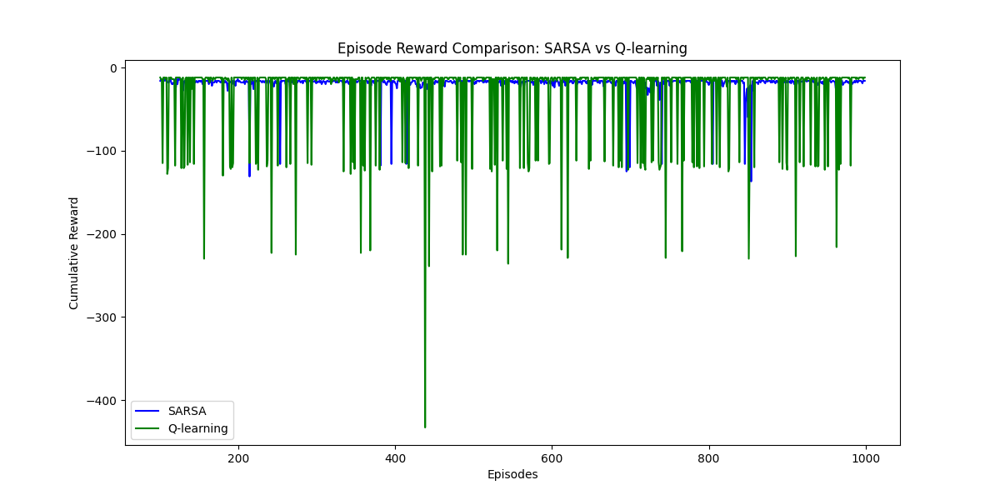

# 基于cliff walk例子实现 Sarsa 和 Q-learning算法

## 1. 问题描述



- **状态空间**：状态由代理的当前位置表示。环境的宽度为 12，高度为 4，因此有 48 个状态（4 * 12）。
  
- **动作空间**：代理可以采取 4 个动作：上（up），下（down），左（left），右（right）。

- **奖励函数**：
  - 到达目标位置，奖励为 0。
  - 如果代理进入悬崖区域，奖励为 -100，且会返回起点。
  - 其他位置，每走一步奖励为 -1。

- **起点和目标**：
  - 起点：位于 `(3, 0)`。
  - 目标：位于 `(3, 11)`。

- **悬崖区域**：悬崖区域从 `(3, 1)` 到 `(3, 10)`，一旦代理进入悬崖区域，奖励会是 -100，并会重置到起点。


## 2. MDP建模

### 2.1 状态空间

状态可以通过一个 `(x, y)` 坐标对表示，其中 `x` 是行（高度），`y` 是列（宽度）。总共有 4 行 12 列，因此状态空间大小为 48。状态空间可以表示为：

- \( S = \{ (x, y) \, | \, 0 \leq x < 4, 0 \leq y < 12 \} \)

### 2.2 动作空间

可以执行 4 种动作：

- **上（up）**：移动到当前位置的上一行。
- **下（down）**：移动到当前位置的下一行。
- **左（left）**：移动到当前位置的左侧列。
- **右（right）**：移动到当前位置的右侧列。

因此，动作空间可以表示为：

- \( A = \{ \text{up}, \text{down}, \text{left}, \text{right} \} \)

### 2.3 状态转移概率

状态转移的概率是确定性的。

- **上（up）**：如果当前位置不是最上面一行，代理将上移一格；否则，保持当前位置。
- **下（down）**：如果当前位置不是最底部一行，代理将下移一格；否则，保持当前位置。
- **左（left）**：如果当前位置不是最左边一列，代理将左移一格；否则，保持当前位置。
- **右（right）**：如果当前位置不是最右边一列，代理将右移一格；否则，保持当前位置。

### 2.4 奖励函数

环境的奖励函数定义如下：

- 到达目标，奖励为 **0**。
- 如果代理进入悬崖区域（`(3, 1)` 到 `(3, 10)`），奖励为 **-100**，且代理会返回起始点 `(3, 0)`。
- 其他状态每步的默认奖励为 **-1**。


## 3. 算法设计

1. **SARSA（State-Action-Reward-State-Action）**：一个基于状态-动作对的强化学习算法，采用在线更新方式，使用 epsilon-greedy 策略进行探索。

2. **Q-learning**：一种 off-policy 强化学习算法，不依赖于当前策略的选择。它通过 Q 表来存储状态-动作值，并通过 epsilon-greedy 策略选择动作。

### 3.1 SARSA 算法

#### 3.1.1 算法描述

SARSA 是一个基于 **策略迭代** 的强化学习算法。其基本原理是通过代理与环境的交互，不断更新状态-动作对的 Q 值，以逼近最优策略。与 Q-learning 不同，SARSA 是 **on-policy** 的，意味着它在学习过程中使用当前策略来生成训练数据。

**SARSA 更新规则**：

\[
Q(s, a) \leftarrow Q(s, a) + \alpha \cdot \left( r + \gamma \cdot Q(s', a') - Q(s, a) \right)
\]

- \( \alpha \) 为学习率，控制更新的幅度。
- \( \gamma \) 为折扣因子，控制未来奖励的权重。
- \( r \) 为当前状态的奖励。
- \( Q(s, a) \) 是当前状态下选择某动作的 Q 值。
- \( Q(s', a') \) 是下一个状态下选择动作 \( a' \) 的 Q 值。

#### 3.1.2 伪代码

1. 初始化 Q 表
2. 重复以下步骤，直到收敛：
   - 从起始状态开始。
   - 根据当前状态 \( s \) 选择动作 \( a \)（epsilon-greedy）。
   - 执行动作，观察奖励 \( r \) 和下一个状态 \( s' \)。
   - 选择下一个动作 \( a' \)。
   - 更新 Q 值：\( Q(s, a) \leftarrow Q(s, a) + \alpha \cdot (r + \gamma \cdot Q(s', a') - Q(s, a)) \)
   - 将 \( s' \) 和 \( a' \) 设置为当前状态和动作。
3. 返回最优策略。

#### 3.1.3 实现代码
```python
# SARSA 算法
class SARSA:
    def __init__(self, env, alpha=0.5, gamma=0.99, epsilon=0.05):
        # 初始化 SARSA 参数
        self.env = env
        self.alpha = alpha   # 学习率
        self.gamma = gamma   # 折扣因子
        self.epsilon = epsilon  # 探索率
        self.q_table = np.zeros((env.height, env.width, len(env.actions)))  # 初始化 Q 表
        self.actions = env.actions
    
    # 选择动作，采用 epsilon-greedy 策略
    def choose_action(self, state):
        if random.uniform(0, 1) < self.epsilon:
            return random.choice(self.actions)  # 探索随机动作
        else:
            x, y = state
            action_values = self.q_table[x, y, :]  # 获取当前状态的所有动作值
            return self.actions[np.argmax(action_values)]  # 选择最大 Q 值的动作
    
    # 更新 Q 表，SARSA 更新公式
    def update(self, state, action, reward, next_state, next_action):
        x, y = state
        next_x, next_y = next_state
        action_idx = self.actions.index(action)  # 当前动作的索引
        next_action_idx = self.actions.index(next_action)  # 下一步动作的索引
        
        q_predict = self.q_table[x, y, action_idx]
        q_target = reward + self.gamma * self.q_table[next_x, next_y, next_action_idx]
        
        # 更新 Q 表
        self.q_table[x, y, action_idx] += self.alpha * (q_target - q_predict)
```


### 3.2 Q-learning 算法


#### 3.2.1 算法描述

Q-learning 是一种 **off-policy** 强化学习算法，代理不依赖于当前策略来生成训练数据。它通过 Q 表来存储状态-动作对的 Q 值，并使用 epsilon-greedy 策略来选择动作。

**Q-learning 更新规则**：

\[
Q(s, a) \leftarrow Q(s, a) + \alpha \cdot \left( r + \gamma \cdot \max_{a'} Q(s', a') - Q(s, a) \right)
\]

- \( \alpha \) 为学习率，控制更新的幅度。
- \( \gamma \) 为折扣因子，控制未来奖励的权重。
- \( r \) 为当前状态的奖励。
- \( Q(s, a) \) 是当前状态下选择某动作的 Q 值。
- \( \max_{a'} Q(s', a') \) 是在下一个状态 \( s' \) 中选择的最大 Q 值。

#### 3.2.2 伪代码

1. 初始化 Q 表
2. 重复以下步骤，直到收敛：
   - 从起始状态开始。
   - 根据当前状态 \( s \) 选择动作 \( a \)（epsilon-greedy）。
   - 执行动作，观察奖励 \( r \) 和下一个状态 \( s' \)。
   - 更新 Q 值：\( Q(s, a) \leftarrow Q(s, a) + \alpha \cdot (r + \gamma \cdot \max_{a'} Q(s', a') - Q(s, a)) \)
3. 返回最优策略。

#### 3.2.3 实现代码
```python
# 选择动作，采用 epsilon-greedy 策略
    def choose_action(self, state):
        if random.uniform(0, 1) < self.epsilon:
            return random.choice(self.actions)  # 探索随机动作
        else:
            x, y = state
            action_values = self.q_table[x, y, :]  # 获取当前状态的所有动作值
            return self.actions[np.argmax(action_values)]  # 选择最大 Q 值的动作
    
    # 更新 Q 表，Q-learning 更新公式
    def update(self, state, action, reward, next_state):
        x, y = state
        next_x, next_y = next_state
        action_idx = self.actions.index(action)  # 当前动作的索引
        
        q_predict = self.q_table[x, y, action_idx]
        # Q-learning 采用最大 Q 值
        q_target = reward + self.gamma * np.max(self.q_table[next_x, next_y, :])
        
        # 更新 Q 表
        self.q_table[x, y, action_idx] += self.alpha * (q_target - q_predict)
```
 

### 3.3. 环境设计与训练


#### 3.3.1 环境设计
编写一个 `CliffWalkEnv` 类，模拟了 Cliff Walk 环境。环境的状态空间为 \(4 \times 12\)，并且通过 `step` 方法计算状态转移和奖励:
```python
# CliffWalk 环境类
class CliffWalkEnv:
    def __init__(self):
        # 环境的宽度和高度
        self.width = 12
        self.height = 4
        # 设置起点和目标点
        self.start = (3, 0)
        self.goal = (3, 11)
        # 悬崖的位置（从(0,1)到(0,10)的区域）
        self.cliff = [(3, x) for x in range(1, 11)]
        # 当前状态（起始位置）
        self.state = self.start
        # 可执行的动作：上、下、左、右
        self.actions = ['up', 'down', 'left', 'right']
    
    # 重置环境状态，返回起始位置
    def reset(self):
        self.state = self.start
        return self.state
    
    # 执行一个动作并返回下一个状态和奖励
    def step(self, action):
        x, y = self.state
        # 根据动作更新位置
        if action == 'up':
            next_state = (max(0, x-1), y)
        elif action == 'down':
            next_state = (min(self.height-1, x+1), y)
        elif action == 'left':
            next_state = (x, max(0, y-1))
        elif action == 'right':
            next_state = (x, min(self.width-1, y+1))
        
        # 如果到达了悬崖，重置到起始位置并返回负奖励
        if next_state in self.cliff:
            next_state = self.start
            reward = -100  # 悬崖的惩罚值
        # 如果到达了目标点，奖励为0
        elif next_state == self.goal:
            reward = 0
        # 否则每步的默认奖励是-1
        else:
            reward = -1
        
        self.state = next_state
        return next_state, reward
```

#### 3.3.2 训练

在每个回合中，智能体从起点开始，在每个状态下选择一个动作，执行该动作并获得新的状态和奖励。然后根据当前的状态、动作、奖励和下一个状态来更新 Q 表;重复以上过程，直到智能体到达到最大训练回合数:

```python
# 运行CliffWalk
def run_agent(env, agent, episodes=1000):
    path = []  # 用于记录每回合的路径
    final_path = []  # 最终路径
    rewards = []  # 记录每一回合的累计奖励
    for episode in range(episodes):
        state = env.reset()  # 重置环境，获取初始状态
        action = agent.choose_action(state)  # 根据当前状态选择动作
        episode_reward = 0  # 每回合的累计奖励
        episode_path = []  # 存储每一回合的路径
        while state != env.goal:  # 直到到达目标
            episode_path.append(state)  # 将当前状态加入路径
            next_state, reward = env.step(action)  # 执行动作，获得下一个状态和奖励
            episode_reward += reward  # 累加奖励
            
            # 根据不同算法更新参数
            if isinstance(agent, SARSA):
                next_action = agent.choose_action(next_state)  # 根据下一个状态选择动作
                agent.update(state, action, reward, next_state, next_action)  # 更新 Q 表
                action = next_action  # 更新当前动作
            elif isinstance(agent, QLearning):
                agent.update(state, action, reward, next_state)  # 更新 Q 表
                action = agent.choose_action(next_state)  # 选择下一个动作
            
            state = next_state  # 更新当前状态
        
        episode_path.append(env.goal)  # 将目标点加入路径
        path.append(episode_path)  # 保存当前回合的路径
        rewards.append(episode_reward)  # 记录当前回合的奖励
    
    # 获取最后一回合的路径，即从起点到目标的路径
    if path:
        final_path = path[-1]
    return final_path, rewards
```


### 3.4 可视化

在训练结束后，绘制了从起点到目标的路径，并展示了环境中的悬崖、起点和目标:
```python
# 绘制迷宫和路径
def plot_maze(final_path, cliff, start, goal, width=12, height=4):
    # 创建一个迷宫图
    maze = np.ones((height, width))  # 初始化迷宫，每个格子设置为 1（表示墙）
    
    # 将悬崖的位置设置为 -1
    for x, y in cliff:
        maze[x, y] = -1  # 设置悬崖
    
    # 将起点设置为 0
    maze[start[0], start[1]] = 2  # 起点为 2
    
    # 将目标点设置为 3
    maze[goal[0], goal[1]] = 3  # 目标点为 3
    
    # 将路径设置为 0.5 或者其他数字
    for x, y in final_path:
        if maze[x, y] != 2 and maze[x, y] != 3 and maze[x, y] != -1:
            maze[x, y] = 0.5  # 设置路径为 0.5，避免与起点和目标点冲突
    
    # 绘制迷宫图
    fig, ax = plt.subplots(figsize=(12, 4))  # 创建图形
    cax = ax.imshow(maze, cmap='coolwarm', interpolation='nearest')  # 显示迷宫
    ax.set_xticks(np.arange(-0.5, width, 1), minor=True)  # 设置横坐标网格
    ax.set_yticks(np.arange(-0.5, height, 1), minor=True)  # 设置纵坐标网格
    ax.grid(which='minor', color='black', linestyle='-', linewidth=1)  # 设置网格线
    
    # 标注起点、目标点
    ax.scatter(start[1], start[0], color='blue', s=100, label='Start', zorder=10)
    ax.scatter(goal[1], goal[0], color='green', s=100, label='Goal', zorder=10)
    
    # 绘制悬崖
    cliff_x, cliff_y = zip(*cliff)
    ax.scatter(cliff_y, cliff_x, color='red', s=100, label='Cliff', zorder=5)
    
    # 绘制最终路径
    path_x, path_y = zip(*final_path)
    ax.scatter(path_y, path_x, color='orange', s=30, label='Path', zorder=3)
    
    # 设置图标题和标签
    ax.set_title('Cliff Walk Environment - Maze Representation')
    ax.set_xlabel('X')
    ax.set_ylabel('Y')
    
    # 添加图例
    ax.legend(loc='best')
    
    # 显示迷宫图
    plt.show()

```
绘制两种算法的奖励对比图:
```python
# 绘制奖励对比图
plt.figure(figsize=(12, 6))
episodes = range(100, 1000)  # 以回合数作为x轴
plt.plot(episodes, sarsa_rewards[100:], label="SARSA", color="blue")
plt.plot(episodes, qlearning_rewards[100:], label="Q-learning", color="green")
plt.xlabel("Episodes")
plt.ylabel("Cumulative Reward")
plt.title("Episode Reward Comparison: SARSA vs Q-learning")
plt.legend()
plt.show()
```

## 4. 实验结果与分析
**超参数设计：**
```
self.alpha = 0.5   # 学习率
self.gamma = 0.99   # 折扣因子
self.epsilon = 0.05  # 探索率
episodes = 1000 # 迭代次数
```
### 4.1 最优策略即最优路径 


#### 4.1.1 SARSA 的路径



#### 4.1.2 Q-learning 的路径




### 4.2 reward对比



#### 4.3 实验结果对比分析

在两者的最终路径上来看：
- Q-learning 和 SARSA 都能成功避免悬崖
- 但 Q-learning 的路径是最优路径，因为它不依赖于当前策略，而是通过最大化未来回报来学习最优策略
- 而SARSA会相对保守。

从reward图看：
- Q-learning 由于其 off-policy 的特性，会大胆尝试比较冒险的策略(像图中有许多掉下悬崖的低分数)，但这也会导致Q-learning会更加激进地尝试更靠近最优策略的路径。
  
- SARSA 更为保守，其更新策略依赖于当前的行动和下一个可能的行动，，这种策略的保守性使得它在某些情况下，尤其是对于高惩罚会尽可能地避免，最后得到的是较安全保守的策略。


## 5. 完整代码
```python
import numpy as np
import random
import matplotlib.pyplot as plt

# 定义 CliffWalk 环境类
class CliffWalkEnv:
    def __init__(self):
        # 环境的宽度和高度
        self.width = 12
        self.height = 4
        # 设置起点和目标点
        self.start = (3, 0)
        self.goal = (3, 11)
        # 悬崖的位置（从(0,1)到(0,10)的区域）
        self.cliff = [(3, x) for x in range(1, 11)]
        # 当前状态（起始位置）
        self.state = self.start
        # 可执行的动作：上、下、左、右
        self.actions = ['up', 'down', 'left', 'right']
    
    # 重置环境状态，返回起始位置
    def reset(self):
        self.state = self.start
        return self.state
    
    # 执行一个动作并返回下一个状态和奖励
    def step(self, action):
        x, y = self.state
        # 根据动作更新位置
        if action == 'up':
            next_state = (max(0, x-1), y)
        elif action == 'down':
            next_state = (min(self.height-1, x+1), y)
        elif action == 'left':
            next_state = (x, max(0, y-1))
        elif action == 'right':
            next_state = (x, min(self.width-1, y+1))
        
        # 如果到达了悬崖，重置到起始位置并返回负奖励
        if next_state in self.cliff:
            next_state = self.start
            reward = -100  # 悬崖的惩罚值
        # 如果到达了目标点，奖励为0
        elif next_state == self.goal:
            reward = 0
        # 否则每步的默认奖励是-1
        else:
            reward = -1
        
        self.state = next_state
        return next_state, reward

# SARSA 算法
class SARSA:
    def __init__(self, env, alpha=0.5, gamma=0.99, epsilon=0.05):
        # 初始化 SARSA 参数
        self.env = env
        self.alpha = alpha   # 学习率
        self.gamma = gamma   # 折扣因子
        self.epsilon = epsilon  # 探索率
        self.q_table = np.zeros((env.height, env.width, len(env.actions)))  # 初始化 Q 表
        self.actions = env.actions
    
    # 选择动作，采用 epsilon-greedy 策略
    def choose_action(self, state):
        if random.uniform(0, 1) < self.epsilon:
            return random.choice(self.actions)  # 探索随机动作
        else:
            x, y = state
            action_values = self.q_table[x, y, :]  # 获取当前状态的所有动作值
            return self.actions[np.argmax(action_values)]  # 选择最大 Q 值的动作
    
    # 更新 Q 表，SARSA 更新公式
    def update(self, state, action, reward, next_state, next_action):
        x, y = state
        next_x, next_y = next_state
        action_idx = self.actions.index(action)  # 当前动作的索引
        next_action_idx = self.actions.index(next_action)  # 下一步动作的索引
        
        q_predict = self.q_table[x, y, action_idx]
        q_target = reward + self.gamma * self.q_table[next_x, next_y, next_action_idx]
        
        # 更新 Q 表
        self.q_table[x, y, action_idx] += self.alpha * (q_target - q_predict)

# Q-learning 算法
class QLearning:
    def __init__(self, env, alpha=0.5, gamma=0.99, epsilon=0.05):
        # 初始化 Q-learning 参数
        self.env = env
        self.alpha = alpha   # 学习率
        self.gamma = gamma   # 折扣因子
        self.epsilon = epsilon  # 探索率
        self.q_table = np.zeros((env.height, env.width, len(env.actions)))  # 初始化 Q 表
        self.actions = env.actions
    
    # 选择动作，采用 epsilon-greedy 策略
    def choose_action(self, state):
        if random.uniform(0, 1) < self.epsilon:
            return random.choice(self.actions)  # 探索随机动作
        else:
            x, y = state
            action_values = self.q_table[x, y, :]  # 获取当前状态的所有动作值
            return self.actions[np.argmax(action_values)]  # 选择最大 Q 值的动作
    
    # 更新 Q 表，Q-learning 更新公式
    def update(self, state, action, reward, next_state):
        x, y = state
        next_x, next_y = next_state
        action_idx = self.actions.index(action)  # 当前动作的索引
        
        q_predict = self.q_table[x, y, action_idx]
        # Q-learning 采用最大 Q 值
        q_target = reward + self.gamma * np.max(self.q_table[next_x, next_y, :])
        
        # 更新 Q 表
        self.q_table[x, y, action_idx] += self.alpha * (q_target - q_predict)

# 运行CliffWalk
def run_agent(env, agent, episodes=1000):
    path = []  # 用于记录每回合的路径
    final_path = []  # 最终路径
    rewards = []  # 记录每一回合的累计奖励
    for episode in range(episodes):
        state = env.reset()  # 重置环境，获取初始状态
        action = agent.choose_action(state)  # 根据当前状态选择动作
        episode_reward = 0  # 每回合的累计奖励
        episode_path = []  # 存储每一回合的路径
        while state != env.goal:  # 直到到达目标
            episode_path.append(state)  # 将当前状态加入路径
            next_state, reward = env.step(action)  # 执行动作，获得下一个状态和奖励
            episode_reward += reward  # 累加奖励
            
            # 根据不同算法更新参数
            if isinstance(agent, SARSA):
                next_action = agent.choose_action(next_state)  # 根据下一个状态选择动作
                agent.update(state, action, reward, next_state, next_action)  # 更新 Q 表
                action = next_action  # 更新当前动作
            elif isinstance(agent, QLearning):
                agent.update(state, action, reward, next_state)  # 更新 Q 表
                action = agent.choose_action(next_state)  # 选择下一个动作
            
            state = next_state  # 更新当前状态
        
        episode_path.append(env.goal)  # 将目标点加入路径
        path.append(episode_path)  # 保存当前回合的路径
        rewards.append(episode_reward)  # 记录当前回合的奖励
    
    # 获取最后一回合的路径，即从起点到目标的路径
    if path:
        final_path = path[-1]
    return final_path, rewards

# 绘制迷宫和路径
def plot_maze(final_path, cliff, start, goal, width=12, height=4):
    # 创建一个迷宫图
    maze = np.ones((height, width))  # 初始化迷宫，每个格子设置为 1（表示墙）
    
    # 将悬崖的位置设置为 -1
    for x, y in cliff:
        maze[x, y] = -1  # 设置悬崖
    
    # 将起点设置为 0
    maze[start[0], start[1]] = 2  # 起点为 2
    
    # 将目标点设置为 3
    maze[goal[0], goal[1]] = 3  # 目标点为 3
    
    # 将路径设置为 0.5 或者其他数字
    for x, y in final_path:
        if maze[x, y] != 2 and maze[x, y] != 3 and maze[x, y] != -1:
            maze[x, y] = 0.5  # 设置路径为 0.5，避免与起点和目标点冲突
    
    # 绘制迷宫图
    fig, ax = plt.subplots(figsize=(12, 4))  # 创建图形
    cax = ax.imshow(maze, cmap='coolwarm', interpolation='nearest')  # 显示迷宫
    ax.set_xticks(np.arange(-0.5, width, 1), minor=True)  # 设置横坐标网格
    ax.set_yticks(np.arange(-0.5, height, 1), minor=True)  # 设置纵坐标网格
    ax.grid(which='minor', color='black', linestyle='-', linewidth=1)  # 设置网格线
    
    # 标注起点、目标点
    ax.scatter(start[1], start[0], color='blue', s=100, label='Start', zorder=10)
    ax.scatter(goal[1], goal[0], color='green', s=100, label='Goal', zorder=10)
    
    # 绘制悬崖
    cliff_x, cliff_y = zip(*cliff)
    ax.scatter(cliff_y, cliff_x, color='red', s=100, label='Cliff', zorder=5)
    
    # 绘制最终路径
    path_x, path_y = zip(*final_path)
    ax.scatter(path_y, path_x, color='orange', s=30, label='Path', zorder=3)
    
    # 设置图标题和标签
    ax.set_title('Cliff Walk Environment - Maze Representation')
    ax.set_xlabel('X')
    ax.set_ylabel('Y')
    
    # 添加图例
    ax.legend(loc='best')
    
    # 显示迷宫图
    plt.show()


# 创建环境
env = CliffWalkEnv()

# 创建SARSA和Q-learning
sarsa_agent = SARSA(env)
qlearning_agent = QLearning(env)

# 运行SARSA
print("Running SARSA...")
sarsa_final_path, sarsa_rewards = run_agent(env, sarsa_agent, episodes=1000)

# 可视化SARSA的最终路径
plot_maze(sarsa_final_path, env.cliff, env.start, env.goal)

# 运行Q-learning
print("Running Q-learning...")
qlearning_final_path, qlearning_rewards = run_agent(env, qlearning_agent, episodes=1000)

# 可视化Q-learning的最终路径
plot_maze(qlearning_final_path, env.cliff, env.start, env.goal)

# 绘制奖励对比图
plt.figure(figsize=(12, 6))
episodes = range(100, 1000)  # 以回合数作为x轴
plt.plot(episodes, sarsa_rewards[100:], label="SARSA", color="blue")
plt.plot(episodes, qlearning_rewards[100:], label="Q-learning", color="green")
plt.xlabel("Episodes")
plt.ylabel("Cumulative Reward")
plt.title("Episode Reward Comparison: SARSA vs Q-learning")
plt.legend()
plt.show()
```
