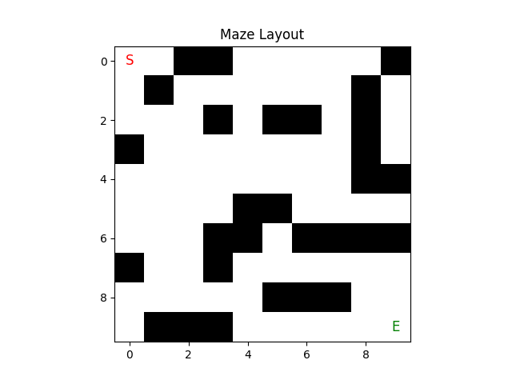
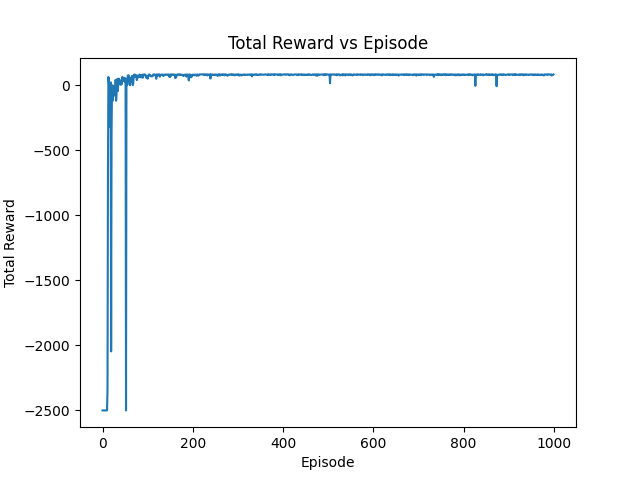
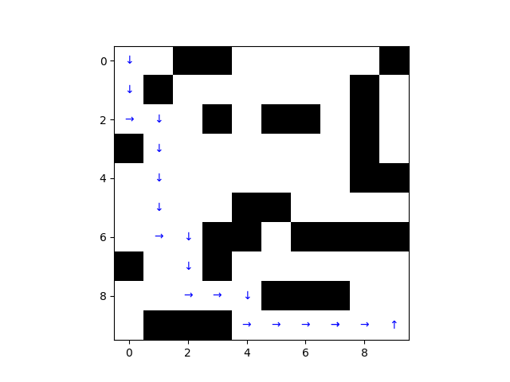

# **基于DQN算法的迷宫问题求解**

## **1. DQN介绍**

深度Q网络（DQN）是一种深度强化学习算法，它结合了Q-learning和深度神经网络的优势。在复杂的环境中，DQN通过学习环境的状态-行动价值函数来选择最优的行动策略。

## **2. 作业案例说明**

本次作业将深度强化学习应用到迷宫求解问题中，设计并实现了一种基于DQN的迷宫求解策略，智能体通过与迷宫环境的互动，逐步学会在迷宫中找到最短路径。



迷宫是一个由随机生成的障碍物和通道组成的网格，智能体的任务是从起点（S）出发，穿越迷宫，最终到达终点（E）。智能体采用DQN算法进行训练，学习如何在迷宫中选择最优的行动（上、下、左、右），并通过不断的训练逐步优化策略。

## **3. 核心理论介绍**

### **3.1 环境设计**

- **状态（State, \(s\)）**：表示环境的当前情况。
- **行动（Action, \(a\)）**：智能体在某一状态下可以选择的行为。
- **奖励（Reward, \(r\)）**：智能体执行某个行动后获得的反馈。
- **策略（Policy, \(\pi\)）**：智能体根据当前状态选择行动的规则。
- **值函数（Value Function, \(V(s)\)）**：估计某一状态的价值，表示从该状态开始的未来预期回报。

### **3.2 DQN算法**

深度Q网络（Deep Q-Network, DQN）是一种结合Q-learning和深度神经网络的强化学习算法。DQN利用神经网络逼近Q值函数，通过状态来预测不同动作的价值（Q值）。DQN的核心思想是在Q-learning的基础上，使用深度神经网络来代替传统的Q值表，从而处理高维、连续的状态空间。

DQN的核心更新公式为：
\[
Q(s_t, a_t) = r_t + \gamma \cdot \max_{a'} Q(s_{t+1}, a')
\]
其中，\(Q(s_t, a_t)\)是当前状态\(s_t\)和动作\(a_t\)的Q值，\(r_t\)是即时奖励，\(\gamma\)是折扣因子。

## **4. 算法设计**

### **4.1 迷宫环境设计**

迷宫环境模拟了一个二维网格，每个单元格可以是通道或障碍。智能体通过选择上、下、左、右四个动作来移动。每次移动后，智能体会根据是否成功到达终点获得奖励。

#### **状态空间**：
- 迷宫的坐标（x, y），即智能体的当前位置。

#### **动作空间**：
- 智能体可以执行四个动作：上、下、左、右。

#### **奖励机制**：
- 移动到终点：奖励 100。
- 移动到其他通道：奖励 -1。
- 碰到障碍：无奖励，保持当前位置。

### **4.2 DQN智能体设计**

DQN智能体由以下部分组成：

- **神经网络**：用于逼近Q值函数，输入为当前状态，输出为每个动作的Q值。
- **经验回放（Experience Replay）**：存储智能体与环境交互的经验，随机采样经验进行训练，以打破数据的时间相关性。
- **目标网络**：为了稳定训练过程，DQN使用目标网络来计算目标Q值，并定期更新目标网络。

智能体的训练过程如下：

1. 初始化Q网络和目标网络。
2. 在每一轮训练中，智能体与环境交互并记录经验。
3. 使用经验回放从存储中随机采样经验，更新Q网络。
4. 定期将Q网络的权重复制到目标网络。

### **4.3 训练流程**

1. 随机生成迷宫。
2. 初始化智能体的Q网络和目标网络。
3. 在每一轮训练中：
   - 智能体选择动作并与环境交互。
   - 根据环境反馈的奖励更新Q网络。
4. 训练完成后，使用学习到的策略来求解迷宫路径。

## **5. 代码实现**

- **迷宫环境类**：随机生成迷宫环境,定义了环境的状态空间、动作空间和奖励机制:
```python
# 随机生成迷宫 (1为障碍，0为通道)
def generate_maze(dim=10, p=0.2):
    maze = np.random.choice([0, 1], size=(dim, dim), p=[1-p, p])  # 以 p 的概率填充障碍
    maze[0, 0] = 0  # 确保起点可通行
    maze[dim-1, dim-1] = 0  # 确保终点可通行
    return maze
# 迷宫环境类
class MazeEnv:
    def __init__(self, maze):
        self.maze = maze
        self.start = (0, 0)
        self.end = (len(maze)-1, len(maze)-1)
        self.state = self.start
        self.actions = [(-1, 0), (1, 0), (0, -1), (0, 1)]  # 上下左右四个方向

    def reset(self):
        self.state = self.start
        return self.state

    def step(self, action):
        row, col = self.state
        new_row, new_col = row + self.actions[action][0], col + self.actions[action][1]

        # 确保新位置在迷宫内部并且是通道
        if 0 <= new_row < len(self.maze) and 0 <= new_col < len(self.maze) and self.maze[new_row][new_col] == 0:
            self.state = (new_row, new_col)
        else:
            return self.state, -1, False  # 无效动作，返回当前状态，奖励-1

        # 检查是否到达终点
        if self.state == self.end:
            return self.state, 100, True  # 终点，奖励100

        return self.state, -1, False  # 普通步伐，奖励-1

```

- **DQN智能体**：DQN网络结构、Q值更新、经验回放、目标网络更新：

```python
# DQN智能体
class DQN(nn.Module):
    def __init__(self, state_dim, action_dim):
        super(DQN, self).__init__()
        self.fc1 = nn.Linear(state_dim, 64)
        self.fc2 = nn.Linear(64, 64)
        self.fc3 = nn.Linear(64, action_dim)

    def forward(self, x):
        x = torch.relu(self.fc1(x))
        x = torch.relu(self.fc2(x))
        x = self.fc3(x)
        return x

class DQNAgent:
    def __init__(self, state_dim, action_dim):
        self.state_dim = state_dim
        self.action_dim = action_dim
        self.model = DQN(state_dim, action_dim)
        self.target_model = DQN(state_dim, action_dim)
        self.target_model.load_state_dict(self.model.state_dict())
        self.optimizer = optim.Adam(self.model.parameters(), lr=0.001)
        self.criterion = nn.MSELoss()
        self.memory = []
        self.epsilon = 1.0  # 探索率
        self.epsilon_decay = 0.995
        self.epsilon_min = 0.1
        self.batch_size = 64
        self.gamma = 0.9  # 折扣因子

    def act(self, state):
        if random.random() < self.epsilon:
            return random.choice(range(self.action_dim))  # 探索
        state_tensor = torch.FloatTensor(state)
        q_values = self.model(state_tensor)
        return torch.argmax(q_values).item()  # 利用

    def remember(self, state, action, reward, next_state, done):
        self.memory.append((state, action, reward, next_state, done))

    def replay(self):
        if len(self.memory) < self.batch_size:
            return

        batch = random.sample(self.memory, self.batch_size)
        states, actions, rewards, next_states, dones = zip(*batch)

        states_tensor = torch.FloatTensor(states)
        next_states_tensor = torch.FloatTensor(next_states)
        rewards_tensor = torch.FloatTensor(rewards)
        actions_tensor = torch.LongTensor(actions)
        dones_tensor = torch.BoolTensor(dones)

        # Q值更新
        q_values = self.model(states_tensor).gather(1, actions_tensor.unsqueeze(1)).squeeze(1)
        next_q_values = self.target_model(next_states_tensor).max(1)[0]
        target_q_values = rewards_tensor + (self.gamma * next_q_values * ~dones_tensor)

        loss = self.criterion(q_values, target_q_values)
        self.optimizer.zero_grad()
        loss.backward()
        self.optimizer.step()

        # 更新目标网络
        self.update_target_model()

        if self.epsilon > self.epsilon_min:
            self.epsilon *= self.epsilon_decay

    def update_target_model(self):
        self.target_model.load_state_dict(self.model.state_dict())
```

- **训练过程**：
训练流程：与环境的交互、Q网络的更新、奖励的记录：
```python
# 训练DQN并记录总奖励变化
def train_dqn(episodes=1000):
    reward_history = []  # 用于记录每一轮的总奖励
    for e in range(episodes):
        state = env.reset()
        total_reward = 0
        done = False
        step = 0
        while not done:
            action = agent.act(state)
            next_state, reward, done = env.step(action)
            agent.remember(state, action, reward, next_state, done)
            agent.replay()
            state = next_state
            total_reward += reward
            step += 1
            if step > 2500: # 防止走不出的情况 陷入死循环
                print(f"Episode {e}/{episodes} Fail to the destination")
                break
        reward_history.append(total_reward)  # 记录每一轮的奖励
        if e % 100 == 0:
            print(f"Episode {e}/{episodes}, Total Reward: {total_reward}, Epsilon: {agent.epsilon:.3f}")
    
    return reward_history  # 返回奖励变化的历史记录
```

- **可视化**：显示迷宫布局、最佳路径和总奖励变化:

```python
# 获取并展示最佳路径的策略
def get_best_policy():
    policy = np.zeros_like(maze, dtype=int)
    state = env.reset()
    path = []  # 保存最佳路径
    while state != env.end:
        row, col = state
        action = agent.act(state)
        policy[row, col] = action
        path.append(state)
        next_state, _, done = env.step(action)
        state = next_state
    path.append(env.end)  # 添加终点
    return policy, path

# 可视化迷宫并显示最佳路径上的箭头
def show_best_path(maze, path, policy):
    fig, ax = plt.subplots()
    ax.imshow(maze, cmap='binary')

    actions_to_char = {
        0: '\u2191',  # ↑
        1: '\u2193',  # ↓
        2: '\u2190',  # ←
        3: '\u2192'   # → 
    }

    # 只绘制最佳路径上的箭头
    for (row, col) in path:
        if maze[row, col] == 0:  # 只有通道上的位置才绘制箭头
            action = policy[row, col]
            ax.text(col, row, actions_to_char[action], ha='center', va='center', color='blue', fontsize=10)

    plt.show()

# 可视化迷宫布局
def show_maze_layout(maze):
    fig, ax = plt.subplots()
    ax.imshow(maze, cmap='binary')  # 二值化的迷宫，障碍物为黑色，通道为白色

    # 标注起点和终点
    ax.text(0, 0, 'S', ha='center', va='center', color='red', fontsize=12)  # 起点
    ax.text(maze.shape[0]-1, maze.shape[1]-1, 'E', ha='center', va='center', color='green', fontsize=12)  # 终点

    plt.title("Maze Layout")
    plt.show()

# 环境与DQN设置
maze = generate_maze(dim=10, p=0.25)
show_maze_layout(maze)

env = MazeEnv(maze)
state_dim = 2  # 状态是坐标(x, y)
action_dim = 4  # 四个方向
agent = DQNAgent(state_dim, action_dim)

# 训练DQN并展示最佳路径
reward_history = train_dqn(episodes=1000)

# 获取最佳策略并计算最佳路径
best_policy, best_path = get_best_policy()

# 可视化最佳路径
show_best_path(maze, best_path, best_policy)

# 绘制总奖励变化图
plt.plot(reward_history)
plt.xlabel('Episode')
plt.ylabel('Total Reward')
plt.title('Total Reward vs Episode')
plt.show()
```


## **6. 实验结果与分析**

### **6.1 训练结果**

经过1000轮训练，智能体逐步学会了迷宫的路径规划。以下是智能体的奖励变化图：



### **6.2 最佳路径可视化**

训练完成后，通过智能体学习到的策略，计算出迷宫问题的最佳路径:




### **6.3 实验结果分析**

可以从奖励的变化图可以看出,一开始智能体无法找到迷宫的出口导致reward极低，但由于初期训练时智能体的探索率较高，智能体在尝试十几轮后成功走到了迷宫出口，此后智能体不断在此基础上学习训练，并做到可以走到迷宫出口，逐渐收敛，最终找到了一条最佳路径。

## **7. 完整代码**


```python
import numpy as np
import random
import torch
import torch.nn as nn
import torch.optim as optim
import matplotlib.pyplot as plt

# 随机生成迷宫 (1为障碍，0为通道)
def generate_maze(dim=10, p=0.2):
    maze = np.random.choice([0, 1], size=(dim, dim), p=[1-p, p])  # 以 p 的概率填充障碍
    maze[0, 0] = 0  # 确保起点可通行
    maze[dim-1, dim-1] = 0  # 确保终点可通行
    return maze

# 迷宫环境类
class MazeEnv:
    def __init__(self, maze):
        self.maze = maze
        self.start = (0, 0)
        self.end = (len(maze)-1, len(maze)-1)
        self.state = self.start
        self.actions = [(-1, 0), (1, 0), (0, -1), (0, 1)]  # 上下左右四个方向

    def reset(self):
        self.state = self.start
        return self.state

    def step(self, action):
        row, col = self.state
        new_row, new_col = row + self.actions[action][0], col + self.actions[action][1]

        # 确保新位置在迷宫内部并且是通道
        if 0 <= new_row < len(self.maze) and 0 <= new_col < len(self.maze) and self.maze[new_row][new_col] == 0:
            self.state = (new_row, new_col)
        else:
            return self.state, -1, False  # 无效动作，返回当前状态，奖励-1

        # 检查是否到达终点
        if self.state == self.end:
            return self.state, 100, True  # 终点，奖励100

        return self.state, -1, False  # 普通步伐，奖励-1

# DQN智能体
class DQN(nn.Module):
    def __init__(self, state_dim, action_dim):
        super(DQN, self).__init__()
        self.fc1 = nn.Linear(state_dim, 64)
        self.fc2 = nn.Linear(64, 64)
        self.fc3 = nn.Linear(64, action_dim)

    def forward(self, x):
        x = torch.relu(self.fc1(x))
        x = torch.relu(self.fc2(x))
        x = self.fc3(x)
        return x

class DQNAgent:
    def __init__(self, state_dim, action_dim):
        self.state_dim = state_dim
        self.action_dim = action_dim
        self.model = DQN(state_dim, action_dim)
        self.target_model = DQN(state_dim, action_dim)
        self.target_model.load_state_dict(self.model.state_dict())
        self.optimizer = optim.Adam(self.model.parameters(), lr=0.001)
        self.criterion = nn.MSELoss()
        self.memory = []
        self.epsilon = 1.0  # 探索率
        self.epsilon_decay = 0.995
        self.epsilon_min = 0.1
        self.batch_size = 64
        self.gamma = 0.9  # 折扣因子

    def act(self, state):
        if random.random() < self.epsilon:
            return random.choice(range(self.action_dim))  # 探索
        state_tensor = torch.FloatTensor(state)
        q_values = self.model(state_tensor)
        return torch.argmax(q_values).item()  # 利用

    def remember(self, state, action, reward, next_state, done):
        self.memory.append((state, action, reward, next_state, done))

    def replay(self):
        if len(self.memory) < self.batch_size:
            return

        batch = random.sample(self.memory, self.batch_size)
        states, actions, rewards, next_states, dones = zip(*batch)

        states_tensor = torch.FloatTensor(states)
        next_states_tensor = torch.FloatTensor(next_states)
        rewards_tensor = torch.FloatTensor(rewards)
        actions_tensor = torch.LongTensor(actions)
        dones_tensor = torch.BoolTensor(dones)

        # Q值更新
        q_values = self.model(states_tensor).gather(1, actions_tensor.unsqueeze(1)).squeeze(1)
        next_q_values = self.target_model(next_states_tensor).max(1)[0]
        target_q_values = rewards_tensor + (self.gamma * next_q_values * ~dones_tensor)

        loss = self.criterion(q_values, target_q_values)
        self.optimizer.zero_grad()
        loss.backward()
        self.optimizer.step()

        # 更新目标网络
        self.update_target_model()

        if self.epsilon > self.epsilon_min:
            self.epsilon *= self.epsilon_decay

    def update_target_model(self):
        self.target_model.load_state_dict(self.model.state_dict())

# 训练DQN并记录总奖励变化
def train_dqn(episodes=1000):
    reward_history = []  # 用于记录每一轮的总奖励
    for e in range(episodes):
        state = env.reset()
        total_reward = 0
        done = False
        step = 0
        while not done:
            action = agent.act(state)
            next_state, reward, done = env.step(action)
            agent.remember(state, action, reward, next_state, done)
            agent.replay()
            state = next_state
            total_reward += reward
            step += 1
            if step > 2500: # 防止走不出的情况 陷入死循环
                print(f"Episode {e}/{episodes} Fail to the destination")
                break
        reward_history.append(total_reward)  # 记录每一轮的奖励
        if e % 100 == 0:
            print(f"Episode {e}/{episodes}, Total Reward: {total_reward}, Epsilon: {agent.epsilon:.3f}")
    
    return reward_history  # 返回奖励变化的历史记录

# 获取并展示最佳路径的策略
def get_best_policy():
    policy = np.zeros_like(maze, dtype=int)
    state = env.reset()
    path = []  # 保存最佳路径
    while state != env.end:
        row, col = state
        action = agent.act(state)
        policy[row, col] = action
        path.append(state)
        next_state, _, done = env.step(action)
        state = next_state
    path.append(env.end)  # 添加终点
    return policy, path

# 可视化迷宫并显示最佳路径上的箭头
def show_best_path(maze, path, policy):
    fig, ax = plt.subplots()
    ax.imshow(maze, cmap='binary')

    actions_to_char = {
        0: '\u2191',  # ↑
        1: '\u2193',  # ↓
        2: '\u2190',  # ←
        3: '\u2192'   # → 
    }

    # 只绘制最佳路径上的箭头
    for (row, col) in path:
        if maze[row, col] == 0:  # 只有通道上的位置才绘制箭头
            action = policy[row, col]
            ax.text(col, row, actions_to_char[action], ha='center', va='center', color='blue', fontsize=10)

    plt.show()

# 可视化迷宫布局
def show_maze_layout(maze):
    fig, ax = plt.subplots()
    ax.imshow(maze, cmap='binary')  # 二值化的迷宫，障碍物为黑色，通道为白色

    # 标注起点和终点
    ax.text(0, 0, 'S', ha='center', va='center', color='red', fontsize=12)  # 起点
    ax.text(maze.shape[0]-1, maze.shape[1]-1, 'E', ha='center', va='center', color='green', fontsize=12)  # 终点

    plt.title("Maze Layout")
    plt.show()

# 环境与DQN设置
maze = generate_maze(dim=10, p=0.25)
show_maze_layout(maze)

env = MazeEnv(maze)
state_dim = 2  # 状态是坐标(x, y)
action_dim = 4  # 四个方向
agent = DQNAgent(state_dim, action_dim)

# 训练DQN并展示最佳路径
reward_history = train_dqn(episodes=1000)

# 获取最佳策略并计算最佳路径
best_policy, best_path = get_best_policy()

# 可视化最佳路径
show_best_path(maze, best_path, best_policy)

# 绘制总奖励变化图
plt.plot(reward_history)
plt.xlabel('Episode')
plt.ylabel('Total Reward')
plt.title('Total Reward vs Episode')
plt.show()

```
